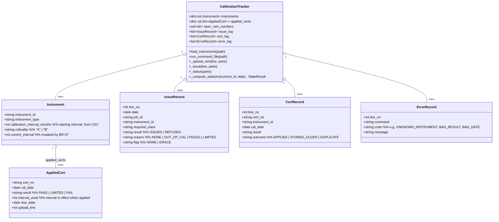
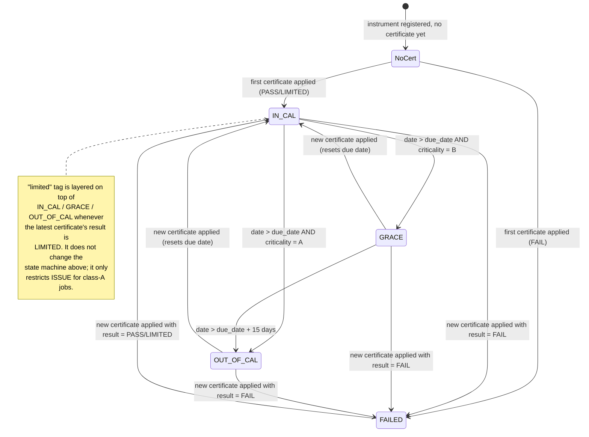

# Design Document — ECE-052 Instrument Calibration Due-Date and Certificate Tracker

**Team:** E006 — Chaitra Kalari (1AT24UE011), Chandana D M (1AT24UE012), Section ECM A
**Domain:** Test Labs — Calibration Management

---

## 1. Glossary

| Term | Meaning |
|---|---|
| Instrument | A multimeter, LCR meter or power supply tracked by the system; has a calibration interval and a criticality. |
| Criticality | A or B. A = zero grace period after the due date. B = 15-day grace period. |
| Certificate | A calibration record for one instrument: cert number, cal date, result (PASS/LIMITED/FAIL), issuing lab. |
| Cal date | The date the instrument was actually calibrated (as opposed to the date the certificate was *uploaded*). |
| Latest certificate | Among all certificates **applied** to an instrument, the one with the greatest cal date. Determines current state. |
| Applied certificate | A certificate whose cal date is strictly after the previous latest cal date, so it becomes the new "latest" and its due date is computed. |
| Stored-older certificate | A certificate whose cal date is on/before the current latest cal date. Kept for the record but does **not** change state (out-of-order upload). |
| Due date | cal date of the latest applied certificate, plus the interval (in months) that was in effect when that certificate was applied. |
| Grace period | The window after the due date during which a criticality-B instrument is still usable (GRACE state). 0 days for criticality A. |
| State | One of IN_CAL, GRACE, OUT_OF_CAL, FAILED — computed on demand for a given date, never stored. |
| Limited | A boolean tag, true when the *latest* certificate's result is LIMITED. Independent of state; restricts which jobs may use the instrument. |
| Interval shortening | Two consecutive *applied* LIMITED results on one instrument halve its calibration interval (floor, minimum 3 months) for certificates applied from then on. |
| Due list | For a STATUS date, every non-FAILED instrument whose due date falls on/before STATUS date + 30 days, in due-date order. |
| Issue | A request from a test job to use an instrument on a given date, for a required accuracy class (A or B). |

---

## 2. Class Diagram



---

## 3. State Diagram (per instrument, evaluated at a given query date)



State is **derived at query time** from the latest applied certificate's `cal_date`, `due_date` and `result`, plus the instrument's `criticality` — it is never stored directly. This is what the brief asks to be able to explain in the viva.

---

## 4. Business Rule Register

| ID | Rule |
|---|---|
| BR-01 | Due date = latest applied certificate's cal date + the interval (months) in effect when it was applied. Same day-of-month; if that day does not exist in the target month, use the last day of that month. |
| BR-02 | States: IN_CAL up to and including the due date. GRACE from due date + 1 day for 15 days (criticality B only). OUT_OF_CAL after grace (or immediately after the due date for criticality A). FAILED whenever the latest applied certificate's result is FAIL — overrides the date-based state entirely, and `due_date` is reported as NONE. |
| BR-03 | ISSUE is refused when the instrument's state is OUT_OF_CAL or FAILED (reason = that state). GRACE instruments may be issued, but the issue-log line carries flag = GRACE. |
| BR-04 | An instrument whose latest certificate result is LIMITED is tagged `limited = true`. It may only be issued to jobs whose required accuracy class is B; a class-A request is refused with reason = LIMITED (checked only if the instrument isn't already OUT_OF_CAL/FAILED — BR-03 takes priority). |
| BR-05 | Certificate ordering: the latest cal date wins. A certificate dated on/before the current latest applied cal date is stored (outcome STORED_OLDER) but does not change state. A certificate number seen before (on any instrument) is rejected (outcome DUPLICATE) and not stored at all. |
| BR-06 | Due list for a STATUS date: every instrument whose state is not FAILED and whose due date is on/before (STATUS date + 30 days), sorted by due date then instrument ID. `days_remaining` = due_date − STATUS date, and can be negative for instruments already overdue. |
| BR-07 | If the last two *applied* certificates for an instrument are both LIMITED, the interval is halved (floor division, minimum 3 months) for certificates applied after that point. The due date of the second LIMITED certificate itself is still computed using the interval that was in effect *before* this halving. |
| BR-08 | Instrument master validation: a row with an interval that is not a positive whole number, a criticality other than A/B, an empty ID, or a duplicate ID is rejected and logged to `error_log.csv`; the first valid row for an ID is kept and loading continues. |
| BR-09 | UPLOAD_CERT validation: wrong field count, invalid date, empty cert number, unknown instrument, or a result other than PASS/LIMITED/FAIL is rejected and logged. A rejected line changes no state and does not "use up" its cert number. |
| BR-10 | ISSUE validation: wrong field count, invalid date, unknown instrument, or a required accuracy class other than A/B is rejected and logged. No issue-log line is written for a rejected request. |
| BR-11 | Command-file robustness: an unknown command, a STATUS with a bad date, or a missing file never crashes the run. Each is logged (with its physical line number) and processing continues with the next line. |

Two implementation decisions not fully spelled out in the brief are recorded in `decision_log.md` (same-day command ordering, and the "no certificate yet" state) — see that file for the reasoning.

---

## 5. Architecture

```
main.py            CLI entry point: wires engine to data/ and output/
src/engine.py       CalibrationTracker — all business logic, pure functions + one stateful class
tests/test_engine.py      Unit tests for BR-01..BR-07 plus a full-pack smoke test
tests/test_validation.py  Tests for BR-08..BR-11 (input validation)
data/                instruments.csv, commands.txt (the sample pack)
output/              state_table.csv, due_list.csv, issue_log.csv, cert_log.csv, error_log.csv (generated)
```

No database, no UI, no external dependencies beyond the Python standard library (`csv`, `dataclasses`, `datetime`) — matches the "command-file driven, no UI" requirement. Everything is evaluated by running `main.py` against a (possibly hidden) data pack and diffing the four graded output CSVs (`error_log.csv` is an extra file and is not part of the graded set) field-for-field, so the engine's I/O contract (column names and order) is the single most important thing to keep exact — see `README.md`'s "Output format" section, which mirrors the sample-data-pack README.
